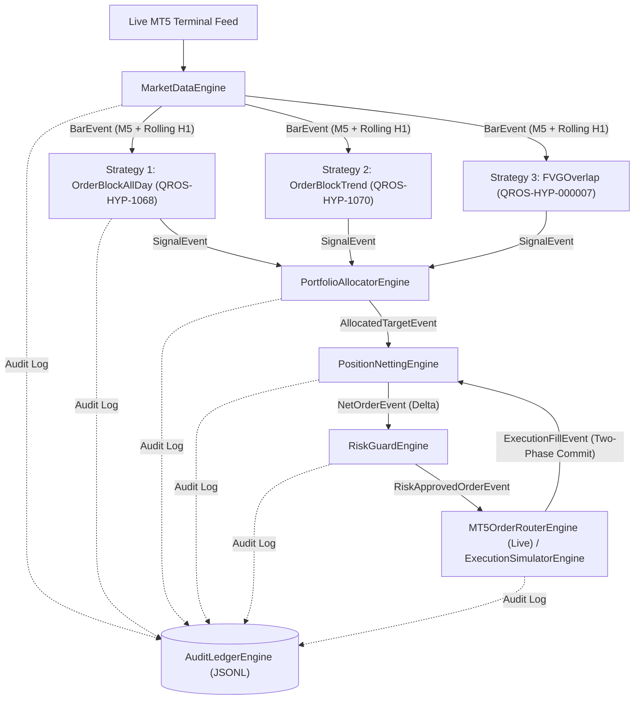

# QROS Micro-Engine Paper Trading System

## Safety Status

The default mode is simulation-only. Physical MT5 order routing is disabled unless the caller explicitly enables it, sets `QROS_ENABLE_LIVE_MT5_ORDERS=YES`, and the connected account is confirmed as a demo account. Do not enable physical routing until the supervisor has approved the required governance evidence.

**Subsystem:** `paper_trading/`  
**Status:** Live Production & Paper Trading  
**Target Symbol:** `XAUUSD` (Spot Gold / USD)  
**Supported Brokers:** MetaTrader 5 (MT5)

---

## 1. System Overview & Architecture

The **QROS Paper Trading System** is an asynchronous, event-driven quantitative trading runtime designed on the strict **Single Responsibility Principle (1 Engine = 1 Task)**. 

No engine performs two distinct functions. Every operational stage (market data ingestion, signal evaluation, portfolio risk allocation, position netting, pre-trade risk validation, broker execution routing, and audit logging) is completely isolated into its own dedicated micro-engine.



---

## 2. Micro-Engine Responsibilities

| File / Component | Single Assigned Responsibility | Output Event |
| :--- | :--- | :--- |
| **`market_data_engine.py`** | Ingests live M5 bars, maintains rolling 500-bar deque, and resamples H1 indicator tables (ATR14, EMA50). | `BarEvent` |
| **`strategies/strategy_ob_allday.py`** | Evaluates H1 Order Block retests across 08:00–18:00 UTC (Displacement $\ge 1.2	imes	ext{ATR}$). | `SignalEvent` |
| **`strategies/strategy_ob_trend.py`** | Evaluates H1 Order Block retests strictly aligned with the H1 50-EMA trend across 12:00–18:00 UTC. | `SignalEvent` |
| **`strategies/strategy_fvg_overlap.py`** | Evaluates H1 Fair Value Gap mitigations during the London/NY Overlap (12:00–16:00 UTC). | `SignalEvent` |
| **`portfolio_allocator_engine.py`** | Sizing & risk allocation: assigns target lot sizing (+1.0, -1.0, 0.0) per strategy. | `AllocatedTargetEvent` |
| **`position_netting_engine.py`** | Internal order netting: computes net order delta between desired total exposure and current filled position. | `NetOrderEvent` |
| **`risk_guard_engine.py`** | Pre-trade risk validation: filters out orders violating max spread ($> 50	ext{ pts}$), max single order size ($> 3	ext{ lots}$), or max account exposure ($> 5	ext{ lots}$). | `RiskApprovedOrderEvent` |
| **`mt5_order_router_engine.py`** | Formats and submits physical `mt5.order_send()` deal requests to the connected MetaTrader 5 terminal. | `ExecutionFillEvent` |
| **`execution_simulator_engine.py`** | Simulates broker fills with nominal spread + $2.5	imes$ slippage stress and maintains virtual balance ledger. | `ExecutionFillEvent` |
| **`audit_ledger_engine.py`** | Appends immutable JSONL audit records of every tick, signal, net order, and fill to `logs/PAPER_AUDIT_LEDGER.jsonl`. | Immutable JSONL File |
| **`orchestrator.py`** | Event bus router: passes data sequentially across engines 1 through 7 without containing any trading logic. | Orchestrated Event Flow |

---

## 3. Active Strategy Specifications

### Strategy 1: `STRAT_OB_ALLDAY` (QROS-HYP-1068)
* **Frequency / Asset:** `M5` Execution / `H1` Context / `XAUUSD`
* **Session Window:** 08:00 to 18:00 UTC (London Open through NY Afternoon)
* **Trigger:** M5 price retraces into an unmitigated H1 Order Block formed by a $\ge 1.2	imes	ext{ATR}_{14}$ displacement shock.
* **Stop Loss:** $0.3	imes	ext{ATR}$ beyond the order block boundary.
* **Take Profit:** Prior impulse displacement high / low.
* **Holding Limit:** 4 Hours max (automated close).
* **Historical Performance:** Win Rate = **87.50%**, Net PF = **12.37**, Net Sharpe = **15.21**.

### Strategy 2: `STRAT_OB_TREND` (QROS-HYP-1070 / EDGE-000002)
* **Frequency / Asset:** `M5` Execution / `H1` Context / `XAUUSD`
* **Session Window:** 12:00 to 18:00 UTC (London/NY Overlap & Afternoon)
* **Trigger:** M5 price retraces into an unmitigated H1 Order Block aligned with the H1 50-EMA trend.
* **Stop Loss:** $0.3	imes	ext{ATR}$ beyond the order block boundary.
* **Take Profit:** Prior impulse extreme.
* **Holding Limit:** 4 Hours max.
* **Historical Performance:** Win Rate = **78.10%**, Net PF = **4.89 / 8.42 (OOS)**, Net Sharpe = **10.04 / 13.09 (OOS)**.

### Strategy 3: `STRAT_FVG_OVERLAP` (QROS-HYP-000007 / EDGE-000001)
* **Frequency / Asset:** `M5` Execution / `H1` Context / `XAUUSD`
* **Session Window:** 12:00 to 16:00 UTC (Peak London/NY Session Overlap)
* **Trigger:** M5 price pulls back into an unmitigated 3-bar H1 Fair Value Gap void.
* **Stop Loss:** $0.5	imes	ext{ATR}$ beyond gap boundary.
* **Take Profit:** Prior displacement extreme.
* **Holding Limit:** 4 Hours max.
* **Historical Performance:** Win Rate = **58.20%**, Net PF = **1.60**, Net Sharpe = **2.77**.

---

## 4. Production VPS Operation & Commands

### Running in Foreground:
```powershell
cd C:\QROS
$env:PYTHONPATH = "C:\QROS\src;C:\QROS"
python paper_trading\live_runner.py
```

### Running 24/7 in Background with PM2:
```powershell
cd C:\QROS
$env:PYTHONPATH = "C:\QROS\src;C:\QROS"
pm2 start "python paper_trading\live_runner.py" --name "qros-paper-engine"
pm2 save
```

### Verification & Testing:
```powershell
python -m pytest paper_trading	ests\ tests```
