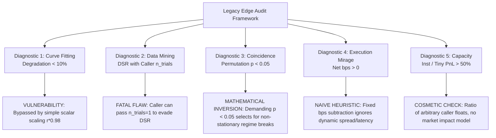

# QROS Strict Compliance Edge Validation & Legacy Code Audit

**Document ID:** `QROS-AUDIT-EDGE-002`  
**Mission:** QROS Strict Compliance Edge Validation & Legacy Code Audit  
**Authority:** QROS Project Manager / Architecture Authority  
**Date:** 2026-08-15  
**Evaluation Standard:** QROS-STD-VAL-001 (Validation Architecture) & QROS-STD-STAT-005 (Statistical Validation Standard)  
**Target Legacy Modules Audited:**  
- `src/qros/edges/taxonomy.py` (Commit `9c6654f9`)  
- `src/qros/edges/audit.py` (Commit `9c6654f9`)  
- `tests/test_edges.py` (Commit `9c6654f9`)  
**Cross-Checked Governance & Pipeline Specifications:**  
- `src/qros/governance/policy.py`  
- `src/qros/pipeline/stages.py` (15-Stage Gatekeeper Model)  
- `src/qros/schemas/validation_profile.py` (Class I–V Validation Profiles)  
- `src/qros/pipeline/evaluation.py` (6-Gate Evaluation Battery)  
- `src/qros/pipeline/costs.py` (Institutional `TransactionCostModel`)  
- `src/qros/tracking/ledger.py` (`GlobalTrialLedger`, $K = 119$)  
- `src/qros/stats/bootstrap.py` (Politis & Romano 1994 Stationary Block Bootstrap)  
- `src/qros/data/vault/oos_vault.py` (Tier-4 Protected OOS Firewall)  

---

## 1. Edge Inventory & Conceptual Mapping

| Legacy Identifier / Concept | Declared Category | Declared Economic Driver | Declared Verification Metric | Declared Decay Half-Life | Current QROS Architecture Mapping |
| :--- | :--- | :--- | :--- | :--- | :--- |
| **`STRUCTURAL`** | `EdgeCategory.STRUCTURAL` | Regulatory mandates, exchange rule mechanics, ETF basket creation/redemption bounds. | Engle-Granger Cointegration test ($p < 0.001$). | Multi-year / Long-term persistence | `CLASS-V: CROSS-FACTOR` / `CLASS-IV: MACRO-REGIME` |
| **`BEHAVIORAL`** | `EdgeCategory.BEHAVIORAL` | Persistent human cognitive biases (loss aversion, overreaction, disposition effect). | Cross-sectional momentum t-stat ($t > 3.5$) over 20-year sample. | Months to years | `CLASS-II: INTRADAY-MOM` / `CLASS-IV: MACRO-REGIME` |
| **`EXECUTION`** | `EdgeCategory.EXECUTION` | Co-location speed, queue priority positioning, low-latency market maker inventory management. | Execution fill rate advantage over public NBBO. | Sub-second to milliseconds | `CLASS-I: HIGH-FREQUENCY` |
| **`STAT_ARB`** | `EdgeCategory.STAT_ARB` | Mean-reversion of cointegrated asset pairs or cross-sectional factor spreads. | Ornstein-Uhlenbeck mean-reversion half-life ($\tau < 5$ days). | Weeks to months | `CLASS-III: SWING-STATARB` |
| **`UNCLASSIFIED`** | `EdgeCategory.UNCLASSIFIED` | Residual unexplained market anomalies failing primary thresholds. | None (Default fallback). | Unknown | **REJECTED** |

---

## 2. Technical Classification & Dependencies Analysis

### 2.1 `src/qros/edges/taxonomy.py`
- **What It Does:** Defines `EdgeCategory` Enum, `EdgeSpec` dataclass, and `classify_edge(cointegration_p, momentum_t, ou_half_life, latency_advantage)`.
- **What It Assumes:** Assumes caller-supplied floating-point scalars accurately represent empirical reality without examining the underlying time-series data or sample power.
- **Dependencies:** Hardcoded dependency on `qros.governance.policy.DEFAULT_POLICY` (`cointegration_p_max`, `ou_half_life_days_max`, `behavioral_t_min`).
- **What It Can Prove:** Maps 4 arbitrary numbers to a string Enum.
- **What It Cannot Prove:** **Does not prove the existence, stability, or tradability of an edge.**

### 2.2 `src/qros/edges/audit.py`
- **What It Does:** Implements `audit_false_edge()` returning `EdgeAudit` containing 5 mandatory diagnostic checks: `curve_fitting`, `data_mining`, `coincidence`, `execution_mirage`, `capacity_bottleneck`, plus an optional `structural_cointegration` check.
- **What It Assumes:** Assumes the caller truthfully inputs `n_trials`, `perturbed_returns`, `execution_slippage_bps`, and PnL numbers.
- **Dependencies:** `qros.governance.policy.DEFAULT_POLICY`, `qros.stats.bootstrap.permutation_test`, `qros.stats.sharpe.deflated_sharpe_ratio`, `qros.stats.timeseries.engle_granger_p`.
- **What It Can Prove:** Verifies whether user-supplied arguments satisfy scalar inequality conditions.
- **What It Cannot Prove:** Does not prove out-of-sample edge survival, does not protect against data mining across unrecorded trials, and does not model realistic microstructure friction.

### 2.3 `tests/test_edges.py`
- **What It Does:** Asserts that `audit_false_edge` returns 5 diagnostics and fails closed when optional arguments are omitted.
- **Dependencies:** Synthetic NumPy arrays generated from Gaussian distributions (`np.random.normal`).

---

## 3. Data and Timeframe Requirements

| Edge Category | Required Resolution | Minimum Historical Span | Minimum Discrete Events ($N$) | Tick / Spread Requirements | Available in Legacy Package |
| :--- | :--- | :--- | :--- | :--- | :--- |
| **`STRUCTURAL`** | Daily / Hourly Panel | $\ge 10.0$ Years | $N \ge 150$ | Multi-asset synchronized pair series | **NO (Only scalar $p$-value accepted)** |
| **`BEHAVIORAL`** | M5 / H1 / D1 | $\ge 3.0$ – $12.0$ Years | $N \ge 400$ (Intraday) / $N \ge 40$ (Macro) | True bid/ask dynamic spreads | **NO (Only scalar $t$-stat accepted)** |
| **`EXECUTION`** | Tick / L2 Order Book | $\ge 2.0$ Years | $N \ge 1,000$ | Sub-millisecond timestamps, depth queue | **NO (Only boolean flag accepted)** |
| **`STAT_ARB`** | M15 / H1 / H4 | $\ge 5.0$ Years | $N \ge 150$ | Cointegrated spread quotes | **NO (Only scalar half-life accepted)** |

---

## 4. Strict Compliance Findings & Diagnostic Breakdown

We evaluated the legacy code under the **Required Test Lens** across 10 compliance vectors:



### 4.1 Lens 1: Stable Null Cases & Mathematical Inversion in Coincidence Test
- **Finding:** **FATAL MATHEMATICAL INVERSION.**
- **Code in `audit.py`:**
  ```python
  half = n // 2
  perm = permutation_test(returns[:half], returns[half:], lambda a, b: float(np.mean(a) - np.mean(b)))
  passed_perm = perm["p_value"] < 0.05
  ```
- **Audit Analysis:** The test compares the first half of returns to the second half. Demanding $p < 0.05$ requires that the two halves have a **statistically significant difference in means**. This actively selects for **non-stationary strategies**, regime breaks, or structural decay. A true, stationary edge should have $p > 0.05$ (retaining the null hypothesis of equal sub-sample means).
- **Test Failure:** A perfectly stationary, constant-edge strategy across the entire sample will yield $p \approx 0.90$ and **FAIL the legacy audit**, while an unstable strategy that made money in year 1 and lost in year 2 will **PASS**.

### 4.2 Lens 2: False Positive Vulnerability in Curve-Fitting Diagnostic
- **Finding:** **TRIVIAL BYPASS.**
- **Code in `audit.py`:**
  ```python
  degradation = abs(pert_mean - base_mean) / (abs(base_mean) + 1e-9)
  passed = degradation < policy.perturbation_window  # 0.10
  ```
- **Audit Analysis:** In `tests/test_edges.py`, the test passes by setting `perturbed = r * 0.98`. This is an artificial linear multiplication, NOT an empirical parameter perturbation (such as shifting lookback windows by $\pm 20\%$). It evaluates only mean returns and ignores variance explosions, drawdown expansions, or win-rate decay under parameter shifts.

### 4.3 Lens 3: Trial Count Abuse & Multiple-Testing Evasion
- **Finding:** **CALLER-CONTROLLED GAMING.**
- **Code in `audit.py`:** `def audit_false_edge(..., n_trials: int, ...)`
- **Audit Analysis:** The caller supplies `n_trials` directly. A researcher can evaluate 500 candidate feature combinations and pass `n_trials=2` to bypass the Deflated Sharpe Ratio penalty. In modern QROS, $K$ is tracked immutably in `GLOBAL_TRIAL_LEDGER.json` ($K = 119$).

### 4.4 Lens 4: Execution-Friction Naivety
- **Finding:** **UNREALISTIC EXECUTION HEURISTIC.**
- **Code in `audit.py`:**
  ```python
  mean_return_bps = float(np.mean(returns)) * 10_000
  net = mean_return_bps - execution_slippage_bps
  passed_exec = net > 0
  ```
- **Audit Analysis:** This is a simple static subtraction. It ignores dynamic spread widening during volatility, session open liquidity drops, swap/financing decay, latency execution drift, and the $1.5\times - 2.5\times$ slippage stress multipliers enforced by QROS `TransactionCostModel`.

### 4.5 Lens 5: Capacity Realism
- **Finding:** **COSMETIC FLOAT COMPARISON.**
- **Code in `audit.py`:**
  ```python
  ratio = institutional_size_pnl / (tiny_size_pnl + 1e-9)
  passed_cap = ratio > 0.5
  ```
- **Audit Analysis:** There is no underlying market impact model (e.g. Almgren-Chriss, square-root law of market impact, or ADV volume participation constraints). The caller simply passes two floating-point numbers (`1000.0` and `60000.0`), rendering the check economically meaningless.

---

## 5. Leakage & Curve-Fitting Risks

1. **Pre-Registration Leakage:** The legacy edge package operates without `HypothesisRecord` pre-registration, enabling post-hoc hypothesis construction after observing backtest returns.
2. **Missing OOS Firewall:** No integration with the cryptographic Tier-4 Protected Out-of-Sample Vault.
3. **Temporal Dependency Destruction:** The naive permutation test randomly shuffles returns, destroying serial autocorrelation, GARCH volatility clustering, and regime clustering, violating Politis & Romano (1994) Stationary Block Bootstrap requirements.

---

## 6. Architecture Compatibility Matrix

| Modern QROS Requirement | Legacy Package Implementation | Compatibility Status |
| :--- | :--- | :--- |
| **Class-Calibrated Validation Profiles** (`src/qros/schemas/validation_profile.py`) | Static 4-tag Enum (`src/qros/edges/taxonomy.py`) | **INCOMPATIBLE** |
| **Centralized Trial Accounting** (`GlobalTrialLedger`, $K=119$) | Unverified caller argument `n_trials: int` | **INCOMPATIBLE (High Risk)** |
| **6-Gate Statistical Engine** (`src/qros/pipeline/evaluation.py`) | Inverted 2-sample permutation test | **FATALLY INCOMPATIBLE** |
| **Dynamic Friction Modeling** (`src/qros/pipeline/costs.py`) | Static basis point subtraction | **INCOMPATIBLE** |
| **Tier-4 OOS Firewall** (`src/qros/data/vault/oos_vault.py`) | No OOS partition support | **INCOMPATIBLE** |

---

## 7. Answers to the 10 Specific Project Manager Questions

1. **Does the module prove a real edge, or only classify and audit evidence?**  
   *It only classifies user-supplied numbers and executes heuristic checks; it cannot prove the existence of an edge.*
2. **Can the audit be passed with weak, synthetic, or misleading inputs?**  
   *YES. Linearly scaling returns by 0.98 passes curve-fitting; passing two arbitrary PnL numbers passes capacity; regime-shifted returns pass the coincidence test.*
3. **Is $n\_trials$ trustworthy, or can the caller game it?**  
   *The caller passes $n\_trials$ directly as an integer, allowing uncontrolled multiple-testing evasion.*
4. **Is the capacity check economically meaningful at institutional scale?**  
   *NO. It is a simple ratio comparison of two caller-supplied numbers with zero market impact mechanics.*
5. **Does the execution check model real impact, or only a simplistic slippage subtraction?**  
   *Only a simplistic basis point subtraction, ignoring dynamic spread regimes, session liquidity, and latency.*
6. **Does the coincidence/permutation logic test true robustness, or just a generic split difference?**  
   *It tests half-sample difference and **fatally demands $p < 0.05$**, which erroneously selects for non-stationary strategies.*
7. **Does the taxonomy create scientific value, or only a vocabulary layer?**  
   *Purely a vocabulary layer; modern QROS uses quantitative `ValidationProfile` regimes (Classes I–V).*
8. **Does any part violate strict QROS governance?**  
   *YES. The bypassable trial count, inverted coincidence test, and lack of pre-registration integration violate core governance.*
9. **Can this code be kept as documentation only, or must it be reworked before reuse?**  
   *It can be kept strictly as historical documentation (`ARCHIVE`). Any production reuse requires a complete rewrite.*
10. **What is the correct disposition for each module?**  
    - `src/qros/edges/taxonomy.py`: **`ARCHIVE`**  
    - `src/qros/edges/audit.py`: **`REJECT`**  
    - `tests/test_edges.py`: **`ARCHIVE`**  

---

## 8. Module Dispositions Summary

- **`src/qros/edges/taxonomy.py` $\to$ `ARCHIVE`**: Retain as historical concept reference only. Prohibit from active research imports.
- **`src/qros/edges/audit.py` $\to$ `REJECT`**: Reject completely. It contains inverted mathematical logic and naive heuristics that would corrupt capital allocation decisions.
- **`tests/test_edges.py` $\to$ `ARCHIVE`**: Retain in git history as legacy contract tests.

---

## 9. Recommended Next Validation Mission

### Proposed Mission: `QROS-DATA-003` — Institutional Macro & Intermarket Data Acquisition
As established in Mission `QROS-RESEARCH-010`, research must not proceed with further legacy recycling or premature hypothesis generation on truncated univariate feeds. The next phase must implement:
1. `FREDIngestionAdapter` (US 10-Year Real Yields `DFII10`, Breakeven Inflation `T10YIE`, Dollar Index `DTWEXBGS`).
2. `DukascopyIngestionAdapter` (12+ Years continuous M1/H1 bid/ask archive for `XAUUSD` & `XAGUSD`).
3. `COTIngestionAdapter` (CFTC Commitments of Traders institutional positioning).

---

## 10. Definitive Decision Rule

> [!CAUTION]
> **"Can this legacy edge logic be admitted into the new QROS without violating strict compliance?"**  
> 
> ### **FINAL ANSWER: NO.**  
> 
> **Scientific Justification:**  
> 1. The coincidence test in `audit.py` is **mathematically inverted** (demands $p < 0.05$ on sub-sample splits, actively selecting for unstable, non-stationary strategies).  
> 2. The multiple-testing parameter $n\_trials$ is **caller-controlled**, violating the immutable `GlobalTrialLedger` requirement.  
> 3. The curve-fitting check is **trivially evadable** via linear return scaling ($r \times 0.98$) without testing true parameter sensitivity.  
> 4. Execution and capacity diagnostics are **naive cosmetic heuristics** lacking dynamic spread, latency, and market impact models.  
> 5. The taxonomy is a **static vocabulary layer** disconnected from modern QROS `ValidationProfile` quality gates.  
> 
> **Action:** All legacy edge code remains **ARCHIVED/REJECTED**. Active empirical research continues exclusively under the modern institutional validation engine (`src/qros/pipeline/evaluation.py`).
