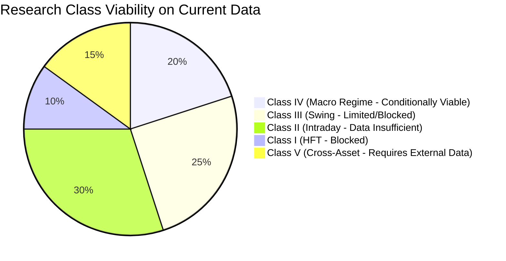

# QROS Data Sufficiency & Research Domain Audit Matrix

**Document ID:** `QROS-CAP-002`  
**Mission:** QROS-RESEARCH-010  
**Asset:** XAUUSD & Auxiliary Target Markets  
**Date:** 2026-08-15  
**Governing Standard:** QROS-STD-VAL-001 Validation Architecture  

---

## 1. Domain-by-Domain Data Sufficiency Matrix

| Domain ID | Research Domain | Current Dataset | Current Span / Bars | Class | Minimum Span Required | Minimum Events ($N$) | Status | Diagnostic Reason | Recommended Action |
| :--- | :--- | :--- | :--- | :--- | :--- | :--- | :--- | :--- | :--- |
| `DOM-01` | Fat-Tailed Returns & Heavy Tail Asymmetry | D1 non-OOS | 14.0y / 3,600 | `CLASS-IV` | 12.0y | 40 | **VIABLE** | Sufficient sample length ($T=3,600$) to estimate 4th moments. | Maintain baseline. |
| `DOM-02` | Volatility Clustering & GARCH Effects | D1 non-OOS | 14.0y / 3,600 | `CLASS-IV` | 12.0y | 40 | **VIABLE** | Long history captures multiple volatility spikes & regimes. | Maintain baseline. |
| `DOM-03` | Intraday Volatility Clustering | M5 non-OOS | 41.6d / 8,000 | `CLASS-II` | 3.0y | 400 | **DATA INSUFFICIENT** | Broker 10k-bar limit prevents multi-year validation. | Acquire 10-year M1/M5 archive. |
| `DOM-04` | Autocorrelation & Serial Independence | M5 / H1 | 41.6d / 1.36y | `CLASS-II` | 3.0y | 400 | **DATA INSUFFICIENT** | High-frequency returns show noise; sample span too short. | Acquire 10-year M1 archive. |
| `DOM-05` | Directional Runs & Momentum | H1 non-OOS | 1.36y / 8,000 | `CLASS-III` | 5.0y | 150 | **LIMITED** | Short span captures only single monetary regime. | Acquire 10-year H1 archive. |
| `DOM-06` | Multi-Day Mean Reversion | D1 non-OOS | 14.0y / 3,600 | `CLASS-IV` | 12.0y | 40 | **VIABLE (FALSIFIED)** | Tested in R007; 3-sigma deviations act as momentum, not MR. | Research alternative MR mechanisms. |
| `DOM-07` | Multi-Day Range Expansion / NR4 / NR7 | D1 non-OOS | 14.0y / 3,600 | `CLASS-IV` | 12.0y | 40 | **VIABLE (FALSIFIED)** | Tested in R009; post-NR4 breakouts fail friction hurdle. | Incorporate macro trend filters. |
| `DOM-08` | Intraday Initial Balance (IB) Breakout | M5 non-OOS | 41.6d / 8,000 | `CLASS-II` | 3.0y | 400 | **DATA INSUFFICIENT** | Only 41.6 days of data ($N=7$ events vs 400 required). | Acquire 10-year M5 archive. |
| `DOM-09` | London/NY Session Volume Surge | M5 non-OOS | 41.6d / 8,000 | `CLASS-II` | 3.0y | 400 | **DATA INSUFFICIENT** | Insufficient seasonal/macro regime coverage. | Acquire 10-year M1 archive. |
| `DOM-10` | Previous-Day High/Low Liquidity Sweeps | H1 non-OOS | 1.36y / 8,000 | `CLASS-III` | 5.0y | 150 | **LIMITED** | Event count $N=42 < 150$; sensitive to spread spikes. | Acquire 10-year H1 tick archive. |
| `DOM-11` | Cross-Timeframe Trend Alignment (D1+H1) | D1 + H1 | Disjoint | `CLASS-III` | 5.0y | 150 | **BLOCKED** | D1 (2009–2023) and H1 (2024–2026) do not overlap in time. | Ingest synchronized multi-TF dataset. |
| `DOM-12` | Macro 50-Day High Breakout Momentum | D1 non-OOS | 14.0y / 3,600 | `CLASS-IV` | 12.0y | 40 | **VIABLE (INCONCLUSIVE)** | Point estimates positive, but Bootstrap CI spans 0. | Test with auxiliary macro filters. |
| `DOM-13` | Real Yield / TIPS Divergence | None | 0 bars | `CLASS-IV` | 15.0y | 50 | **REQUIRES EXTERNAL DATA** | US 10Y real yields not available in MT5 feed. | Ingest FRED `DFII10` series. |
| `DOM-14` | Gold/Silver Ratio (XAU/XAG) Stat-Arb | None | 0 bars | `CLASS-V` | 10.0y | 150 | **REQUIRES EXTERNAL DATA** | Silver (XAGUSD) history not ingested into QROS vault. | Ingest XAGUSD historical dataset. |
| `DOM-15` | Institutional CFTC COT Positioning | None | 0 bars | `CLASS-IV` | 15.0y | 50 | **REQUIRES EXTERNAL DATA** | Weekly COMEX Managed Money data not ingested. | Ingest CFTC COT historical archive. |
| `DOM-16` | Currency Basket Denominator Arbitrage | None | 0 bars | `CLASS-V` | 15.0y | 100 | **REQUIRES EXTERNAL DATA** | DXY, XAUEUR, XAUJPY series not ingested. | Ingest FX denominator panel data. |
| `DOM-17` | Limit Order Book Imbalance / Microstructure | None | 0 bars | `CLASS-I` | 2.0y | 1,000 | **BLOCKED** | L2/L3 order book data not available from retail broker. | Prohibit Class I until tick provider added. |
| `DOM-18` | Diurnal Spread Expansion / Roll Decay | M5 non-OOS | 41.6d / 8,000 | `CLASS-II` | 3.0y | 400 | **DATA INSUFFICIENT** | Spread proxy in MT5 is static/coarse, not true bid/ask tick. | Acquire true bid/ask tick archive. |

---

## 2. Research Class Viability Summary

### Strategic Key Takeaways:
1. **Class I & II (Microstructure & Intraday):** 100% blocked by retail MT5 broker feed depth.
2. **Class III (Swing):** Structurally crippled by timestamp misalignment across timeframes.
3. **Class IV (Macro):** Only univariate price series available; fundamental monetary drivers missing.
4. **Class V (Cross-Asset Factor):** Unusable without multi-asset ingestion adapter.
