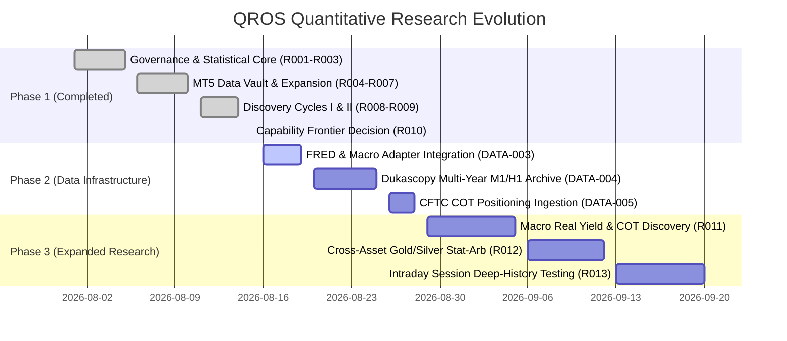

# QROS Research Capability & Next-Phase Execution Roadmap

**Document ID:** `QROS-ROADMAP-001`  
**Mission:** QROS-RESEARCH-010  
**Status:** Approved Strategic Roadmap  
**Authority:** QROS Architecture Authority  
**Date:** 2026-08-15  

---

## 1. Executive Roadmap Overview

This roadmap defines the sequenced execution path to expand QROS quantitative data capabilities, resolve structural data limitations, and systematically unlock high-conviction research classes without violating multiple-testing or OOS governance.

---

## 2. Phase 2: Data Infrastructure Expansion (Prerequisite)

### Mission QROS-DATA-003: Macroeconomic & Real Yield Ingestion Adapter
- **Objective:** Build `FREDIngestionAdapter` to acquire 20+ years of daily US 10-Year Real Yields (`DFII10`), Nominal Yields (`DGS10`), Breakeven Inflation (`T10YIE`), and Dollar Index (`DTWEXBGS`).
- **Deliverable:** `src/qros/data/adapters/fred_adapter.py`, normalized Parquet datasets `QROS-DATA-MACRO-v1.0.0`, SHA-256 manifest registration, 4-tier chronological splitting.

### Mission QROS-DATA-004: Multi-Year Intraday & Intermarket Archive Acquisition
- **Objective:** Build `DukascopyIngestionAdapter` to download and normalize 12+ years (2012–2024+) of continuous M1/H1/D1 data for `XAUUSD`, `XAGUSD`, and `EURUSD` with genuine dynamic bid/ask quotes.
- **Deliverable:** `src/qros/data/adapters/dukascopy_adapter.py`, normalized Parquet datasets `QROS-DATA-XAUUSD-v4.0.0` and `QROS-DATA-XAGUSD-v1.0.0`, eliminating the 10,000-bar limit.

### Mission QROS-DATA-005: Institutional Positioning (CFTC COT) Adapter
- **Objective:** Build `COTIngestionAdapter` to acquire historical weekly Commitments of Traders data for COMEX Gold and Silver.
- **Deliverable:** `src/qros/data/adapters/cot_adapter.py`, point-in-time publication lag verification.

---

## 3. Phase 3: High-Conviction Empirical Research Cycles

### Cycle III (QROS-RESEARCH-011): Macro Real Yield & Institutional COT Hypotheses
- **Target Classes:** `CLASS-IV` (Macro Regime) & `CLASS-III` (Swing Stat-Arb).
- **Core Phenomena:** Real yield divergence momentum, commercial hedger exhaustion reversions, breakeven inflation breakout expansion.
- **Sample Power:** 15–20 years of continuous daily data ($T \ge 4,000$, $N \ge 60$ macro events).

### Cycle IV (QROS-RESEARCH-012): Cross-Asset Relative Value (Gold vs Silver)
- **Target Class:** `CLASS-V` (Cross-Asset Factor / Stat-Arb).
- **Core Phenomena:** Gold/Silver ratio (GSR) cointegration mean reversion, cross-currency gold pricing divergence.
- **Sample Power:** Synchronized daily/hourly panel series ($T \ge 4,000$).

### Cycle V (QROS-RESEARCH-013): High-Power Intraday Momentum Validation
- **Target Class:** `CLASS-II` (Intraday Session & Momentum).
- **Core Phenomena:** Re-evaluate `QROS-HYP-000001` (London Open Breakout) and `QROS-HYP-000002` (Range Compression) across **10 full years of continuous M5 data** ($N \ge 600$ trades), definitively resolving `DATA INSUFFICIENT` status.

---

## 4. Key Governance Safeguards

1. **No Edge Promoted Without OOS Verification:** No candidate will be confirmed until it passes both In-Sample Bootstrap/DSR hurdles and strict, single-run evaluation on the Tier-4 Protected OOS Vault.
2. **Monotonic Ledger Tracking:** All trials in Phases 2 and 3 continue incrementing $K$ from $K = 119$.
